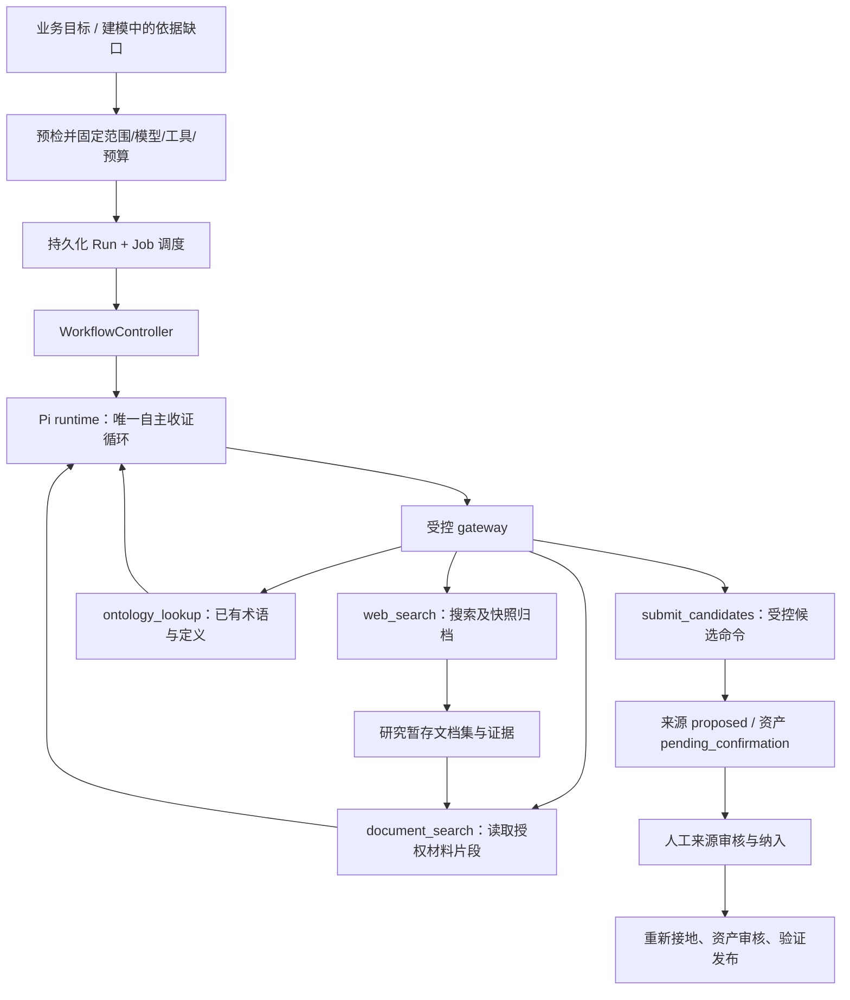

# 设计：AI 搜寻/研究 agent 化

状态：2026-10-16 设计稿（Codex 产出，待评审）。基线：main `1f91ba2`，分支 `docs/v03a-agentic-research`。

定位：把「AI 搜寻公共资料」从固定的"检索→归档→候选"管道，改成**建模助手的一种执行模式**——用户给业务目标，agent 在授权范围内多轮检索、阅读、提交候选；来源确认/资产审核/验证发布继续由现有工作台承接；搜索后端进入「AI 设置」，并至少给出一个无需自建网关的原生适配器。

相对现有设计稿（`tasks/design-core-knowledge-workbench-2026-10-15.md`）明确调整两点：
- §2.3 的**固定研究链** → runtime **自主收证循环**。
- 原「来源确认后才生成候选」→ **可先提取待确认候选**；来源审核、纳入与重新接地后才有资格进入正式资产审核（产品行为增量，须同步改研究契约，不得靠放松 `SourceGroundingService` 的 approved 检查实现）。

## 1. 仓库核对（修正设计假设）

| 核对结果 | 对设计的影响 |
|---|---|
| `WebResearchService` 直接执行 `query: brief.goal`，一次搜索后登记来源 | 现无自主规划/按结果补查的循环 |
| `ResearchWorkflowService` 已有 job、预算预留、来源计数、取消，但执行固定链路 | 保留异步入口与历史；**替换执行内核**，不新增第二套调度 |
| 正常 Core gateway 注册了三个 handler；研究 provider 在后续 runtime 装配阶段独立创建 | 只配搜索连接不够，必须把 `web_search` 接入**实际运行 gateway** |
| 搜索适配器已归档原始页面/派生文本/manifest；但 `WebSearchHandler.toEvidence()` 未传出这些引用 | 必须补 agent 从搜索结果读**真实页面**的路径，摘要不能当原文 |
| Pi 已有工具循环/checkpoint/取消/共享预算；控制器结束路径面向答案生成与核验发布 | 复用执行机制；新增"工作区研究/候选交付"任务语义，**不能把研究结束映射成答案发布** |
| 来源审核/纳入文档集/定义与规则候选生成/低信任阻断均已实现 | 不重复建设；补"未审核材料可研究但不能成为正式依据"的暂存边界 |
| 模型连接目录/能力分配/执行绑定/`AiSettingsPanel` 已实现 | 搜索设置**沿用这套交互与版本语义**，不当作待建基础设施 |

## 2. 入口收敛到业务目标

第一屏保留"希望整理哪个领域，或解决什么问题？"。建工作区后，目标直接成为建模助手的任务，不再要求重填研究表单。开始前给紧凑任务确认区：目标与必须覆盖的问题；公共检索范围/时间版本要求；**实际使用的研究模型、搜索服务、会外发的内容**；可执行次数/token/来源数/候选数/时限；「开始调研并提出候选」。域名、候选种类和额度放"范围与限制"展开区。首次无空间允许域名时引导管理员配置；agent 可建议范围、**不能自行授权**。

三料源入口统一：AI 搜寻 → 打开同一建模助手（带目标+来源缺口）；上传/粘贴 → 现有来源流程（可选"让助手基于这些资料继续整理"）；接入结构化数据 → 保留文件映射；不因 agent 化改变记录确认与发布规则。

行业工作台概览展示目标/研究活动/待处理候选；「来源」负责原件与来源审核；「资产」负责定义/规则/动作候选；「审核/验证与发布」职责不变。**项目工作台不自动获得研究材料，也不继承制作工作区的连接配置。**

`ResearchPanel` 拆出可复用的**授权摘要/进度/历史**组件，移除独立长表单；保留 `?research=<id>` 深链接。

## 3. 可见性（操作/用量/缺口，不看模型内部推理）

运行中显示持久化活动：如"正在补查『停机条件』的适用版本 / 已完成检索 2 次·归档 6 份来源·提出 9 个候选 / 仍缺：点检频次的正式依据 / [查看本轮检索与来源] [停止调研]"。展示检索式、域名、阅读原文位置、候选提交回执、失败原因与下一步摘要；**不展示隐藏思维过程**，不把计划步骤当完成进度。

覆盖按 `mustCover` 呈现"未查/找到材料/有冲突/待确认"；"找到材料"≠已证明正确；不用无法解释的百分比。

| 情况 | 行为与后端语义 |
|---|---|
| 刷新/断网/关页 | 重新订阅原执行；不建新任务 |
| 点停止 | 取消中→已取消；保留已提交候选，禁止后续提交 |
| worker 崩溃 | 从兼容 checkpoint 恢复，沿用原账本/绑定/deadline |
| 暂时性失败 | 仅在剩余额度内重试；未知计费先协调 |
| 已取消/额度耗尽/deadline 过 | 原执行不可复活；提供"基于已有结果**追加调研**"（关联新执行、新额度） |
| 来源待审核 | 研究执行已结束，工作流待人工；不让 agent 空转等待 |
| 配置撤销/运行版本不兼容 | 明确阻断原因；不偷偷换服务商/runtime |

首期只提供"停止调研"，不提供含义模糊的"暂停"。结束给三组产物：**候选来源、候选资产、未解决问题**。

## 4. 研究与建模共用一个执行闭环



"研究 agent"和"建模 agent"是**同一助手的两种任务配置**，不是相互调用的两个自主 agent：从空工作区开始以公共研究为主；建模中发现缺依据，用同一运行中的研究工具集补查；同一执行内检索/阅读/提取/修复共享预算，不嵌套再起 `research-runs`；人工审核后继续建模是**新的明确操作**（可关联前次执行与候选，不伪装成失败重试）。已有生成服务保留为有界操作；agent 已产生结构化候选时复用其解析/校验/接地/提交逻辑，不额外重生成。

**多来源组合（本方案核心能力）**：同一次研究在**同一个证据集**上工作，可组合——
- **公共检索归档**（研究暂存文档集）；
- **已上传/已授权资料**（`document_search` 定向读取既有语料）；
- **已有定义与资产**（`ontology_lookup`）。

`submit_candidates` 的**一个候选可携带多条来源证据**（各自 locator / digest / parser version），不要求单一来源；同一规则的前提也可分别落到不同来源。**来源审核按来源分别进行**：候选在任一相关来源未确认时保留 `pending_confirmation + SOURCE_TRUST_BLOCKED`，全部相关来源审核+纳入+重新接地后才进入正式资产审核。三料源入口**互不排斥**，共享同一个来源/资产/审核管道（上传资料、AI 研究来源、结构化映射的记录可共同支撑同一批候选）。

## 5. 四个公共数据工具不变，候选提交单独建模为受控命令

不能只向 SDK 塞一个字符串 `submit_candidates`，也不能把写候选藏进 `data_query`/compute。建议新增版本化运行时动作联合：

```text
AgentAction = data_tool(existing ToolCall) | authoring_command(SubmitCandidatesCommand)
```

`submit_candidates` 模型侧表现为可调用能力、平台侧是**工作区写命令**：公共 `ToolId` 仍为四个；扩展 gateway 契约增命令调用与回执分支（沿用身份/Schema/预算/intent/取消/审计）；application 实现候选提交端口、composition 注入、`tool-services` 不反向依赖 application；同步调整生成模型协议适配/Pi stream/事件/checkpoint/运行时能力声明（不能只改 TS 枚举）；本地与 MCP 同一命令服务与授权规则，普通数据工具会话不自动获得候选写权限。**这需要在 ADR-04/C4 明确"公共数据工具 vs 受控创作命令"边界。**

Pi 需获得真实参数 Schema、用途、结果引用与限制说明（当前是通用参数对象 + 简短描述，不能只靠提示词）；验收确认任务系统指令实际传入 `GenerationPort`。

## 6. 归档页面必须能读，未审核页面必须与正式语料分开

保留快照归档位于 `web_search` 受控实现内部，不增加任意 `fetch_url`。工具结果区分两类发现：
- `archived`：原始快照、manifest、解析版本、可读文档引用、抓取时间、内容 digest。
- `discovery_only`：URL、搜索摘要、不可归档原因；**不能**用它提交"已由原文支撑"的候选。

归档后建**研究暂存文档集**（按 `tenant/space/workspace/run` 绑成员），复用解析/片段读取/索引设施，但**不属于已批准的 `GroundingDocumentSet`、不进入项目 corpus**。

`document_search` 增**版本化定向读取**（指定已授权文档/片段 + 有界游标），让 agent 从搜索结果继续读正文而非反复搜摘要；索引未就绪时可直接读已归档片段（不把"尚未索引"当"没有内容"）。每次读取绑定文档版本/locator/quote digest/parser version；截断显式返回。Pi 的字符串截断改成结构化预览与读取引用。

`ontology_lookup` 同样需工作区绑定（只看本次固定草稿与已挂载定义，区分草稿/候选/已发布；不伪造项目上下文）。

## 7. 候选提交只接受已取得的证据，可信类别由服务端决定

`SubmitCandidatesCommand@1` 用判别联合：来源候选（本执行已归档页面引用+理由）/ 定义候选（object/attribute/relation 既有结构+证据片段+理由）/ 规则·动作候选（既有规则 AST/动作声明+逐项来源定位+依赖引用）。模型**不能**提供可信身份、审核结果、发布状态或自定义 `trustTier`。新网页来源由服务端固定为 `kind=web_fetch / trustTier=agent_researched / reviewState=proposed`。模型可提交"疑似官方规范"的说明与依据，但只是审核提示；搜索排名/模型概率/来源类别分别表达，不生成"可信度 92%"。

提交服务依次检查：① 运行/操作者/工作区/命令权限；② 证据是否来自本次授权读取、可回读且 digest 一致；③ 候选 Schema/术语冲突/规则依赖/动作绑定/数量上限；④ 当前工作区修订与取消/撤权 fence；⑤ 事务中写候选、来源关联、幂等回执。角色沿用：`researcher` 可提出来源；定义/规则·动作写入要求对应编辑权限；worker 承接原授权。

新候选引用未确认来源时保留原文定位并标 `pending_confirmation` + `SOURCE_TRUST_BLOCKED`；来源人工审核通过后：`审核来源 → 纳入正式文档集 → 保留候选内容、重新接地 → 新候选版本 → 资产审核 → 验证发布`。来源提升类别不能原地洗掉旧候选阻断信息；只批来源/只批候选都不能绕过 P4a。幂等键由宿主结合运行+逻辑动作+内容摘要生成；"提交成功但 checkpoint 未写"恢复返回原回执；同页新版本保留为不同证据（不只按 URL 覆盖）。

## 8. 控制器增加研究任务语义，Job 只负责调度

扩展现有运行契约而非再造控制器：

| 部分 | 调整 |
|---|---|
| 执行目标 | 增 `industry_workspace_research`（固定工作区草稿版本），与项目问答形成判别联合 |
| `RunManifest` | 固定 brief、运行目的、runtime、模型绑定、工具绑定、授权回执、唯一账本、输入清单 |
| `WorkflowController` | 增研究完成分支；收证循环仍交给一个 runtime |
| `ResearchWorkflowService` | 收敛为启动/查询兼容门面，移除直接调 provider 的执行分支 |
| research job | 调度既有运行，不再拥有独立研究循环/重复账本 |
| `ResearchExecution@2` | 作为运行投影，区分执行状态/人工待办/停止原因 |
| 研究结果 | 候选回执、证据清单、覆盖缺口、用量；不是正式答案或行业包 |

`collection_complete` 只允许控制器整理交付清单；若额外生成面向用户的事实性研究总结，仍要走同版草稿核验，不能直接展示 SDK 最后一条自然语言消息。同一研究执行**只有一个账本**（归档下载/分页/重试也纳入限制）。预算至少含：总调用/搜索次数/模型 token·轮数/来源数/候选数/下载与读取字节/并发/修复次数/deadline；以部署研究策略为上限、用户只能收紧。取消先持久化 fence 再传播 AbortSignal；每次候选写事务复查 fence；无法取消的外部调用进入 abandoned（迟到数据仅留审计，不增候选）。

## 9. AI 设置增加"能力与工具"，搜索不再依赖自建网关

`AiSettingsPanel` 增"能力与工具"页签（如：公共网页搜索 · 服务 Tavily/兼容 HTTP 网关 · 凭据已配置 · 分配 空间默认/工作区覆盖/停用 · 搜索测试通过·修订 3 · 页面归档测试通过/部分可用 · [编辑][测试][查看生效详情]）。模型连接与工具连接**不同实体**：`research` 属模型能力，`web_search` 属工具能力，不能把搜索服务注册成生成模型。

首期两个适配器：**原生 Tavily Search**（可直接用的实现，建议关闭其答案生成与自动参数扩展，固定搜索策略；原始页面归档仍由平台控制）与**现有 HTTP provider**（命名"兼容网关"，保留旧部署）。建议基线未验证网络可达性与中文行业检索质量——"接口适配完成"不等于真实可用验收。

新增契约/端口：`ToolConnectionDescriptor/Summary`、`ToolAssignmentSet`（工作区/空间的 inherit/disabled/connection，首期按工具分配）、`EffectiveToolSelection`、`ExecutionToolBinding`、`ToolConnectionProbePort`（搜索/归档分项探测）、`ToolConnectionStore`。复用模型设置的 CAS/凭据托管/复制不带密钥/删除引用检查/本机管理员边界；普通编辑者只选已授权连接；**连接使用权≠可扩域名或放宽预算**。配置更新只影响新执行；恢复用旧绑定；停用/撤销凭据/撤权立即阻断；选定连接失效**不自动切换**。

探测不能只是 `GET /health`：搜索测试发一次明确小额度真实查询（验证认证/映射/超时）；归档测试读取获准测试页（验证字节/digest/片段回读）；两项分别展示；草稿测试绑草稿摘要，改连接或凭据后旧结果失效；探测有独立限额/限流/审计、不建业务候选。**出站服务地址与被搜索页面域名是两类策略**；现有归档器依赖域名列表与部署出站控制，尚不能据此宣称 DNS/私网目标防护完成——保存/测试/运行都需统一网络目标约束。

## 10. API 与迁移（增量演进）

新增/升级：`POST .../research-preflights`（返回实际接收方、有效范围、额度、阻断项、短期授权摘要）；`POST .../research-runs`（`@2` 启动 agent，202 返回 research/run/job）；`GET .../research-runs/:rid`（状态/覆盖/用量/候选回执/恢复动作）；复用既有 run events API + 研究投影；`POST .../:rid/cancel`；`POST .../:rid/resume`（仅恢复允许的非终态，沿用原绑定与预算）；`POST .../:rid/continuations`（追加调研，关联前次产物+新授权）；`/core/ai/tool-connections`（CRUD/credential/copy/test）与 `/tool-connection-tests`（草稿）、`/tool-assignments`、`/effective-tools`。候选命令不开放裸写接口；若 HTTP/MCP 暴露必绑受控执行、调用同一提交服务。**运行入口即使搜索未配置也应存在**，返回稳定能力阻断原因（不因未装配 provider 而 404）。

迁移：追加 migration，保留旧研究记录与 `@1` 解析（历史不伪装成 agent 运行）；从现有 env 一次性导入兼容网关连接+分配（幂等、不覆盖后续 UI 修改；切目录管理后 env 不再成第二真值）；旧运行中任务按旧版本完成/取消，不中途换引擎；旧同步 `/research` 暂留受限兼容路径+弃用说明（不改 201→202，不保留弱授权入口）；新增工具连接/分配/绑定、研究文档成员、命令回执；复用既有 run/预算/事件/候选/不可变工件存储；所有新表/引用/唯一键纳入 tenant/space 并对 workspace/run 做归属校验。

## 11. 节点与 wave（R00~R11）

| 节点 | 类型 | 依赖 | scope | 验收 |
|---|---|---|---|---|
| R00 固定研究与命令契约 | infra/docs | — | A 设计/SPEC、contracts Schema 与生成物 | 明确四工具与命令边界；@1/@2 兼容；状态/预算/来源语义无歧义 |
| R01 工具连接目录与执行绑定 | backend | R00 | application 设置服务、PG、凭据、AI HTTP | CAS/分配/撤销/固定版本/env 幂等迁移；跨范围不可见 |
| R02 原生搜索与双层探测 | backend | R00 | search-web、probe 适配器 | 原生服务无需自建网关；分类错误/取消/usage；搜索与归档分别测试 |
| R03 研究快照与可读文档集 | backend | R00 | web handler、解析/索引、研究成员存储 | 搜索后能读真实片段；link-only 不可引用；暂存与正式 corpus 隔离；研究与上传/授权资料可组合进同一证据集 |
| R04 工作区运行与控制器 | backend | R00 | runs/workflow、Pi/Template、generation 协议、dispatch | 一个循环与账本；工作区上下文；候选完成分支；checkpoint/取消正确 |
| R05 受控候选提交与重新接地 | backend | R03 | definition/rule-action/source services、命令端口、回执 | 重用校验；低信任待确认；**一个候选可带多来源证据**；伪证据拒绝；重复提交幂等；审核后新版本接地 |
| R06 搜索执行装配与能力预检 | backend | R01,R02,R03,R04 | composition、gateway factory、研究 API | runtime 能调绑定搜索；权限/域名交集；未配置有稳定原因；不静默回退 |
| R07 目标入口与研究活动界面 | frontend | R00 | 首页、工作区助手、ResearchPanel 拆分、API client | 目标一次输入；事件/用量/缺口；停止/刷新/恢复；三料源同入口 |
| R08 AI 工具设置界面 | frontend | R01,R02 | AiSettingsPanel、连接编辑/分配/探测 | UI 配测搜索；权限可见性；草稿结果失效；密钥清理；生效版本解释 |
| R09 来源与资产审核衔接 | fullstack | R05,R07 | 来源/资产工作台、审核状态投影 | 待确认产物可回看；来源审核≠可信提升；**多来源分别审核、全部确认后才进正式资产审核**；重新接地保留内容与历史 |
| R10 主入口切换与迁移验证 | fullstack | R05,R06,R07,R08 | Core/worker 总装配、旧入口桥接、迁移验证 | 普通启动走 agent 链；新旧记录可读；运行中不换引擎；无模型/搜索可退化 |
| R11 整栈与可替换性验收 | infra/docs | R09,R10 | integration/conformance/E2E/部署说明 | 真实 PG/runtime/搜索切片；审核到发布；取消/越权/预算/迁移故障验证 |

```
Wave 0：R00
Wave 1：R01、R02、R03、R04、R07
Wave 2：R05、R06、R08
Wave 3：R09、R10
Wave 4：R11
```

R07 可基于固定契约并行开发（前端替身验收≠整栈通过）。contracts 出口由 R00 管；运行契约与控制器由 R04 管；总装配由 R10 集成；migration 号预分配。

R11 必须证明"**结果驱动下一步**"：首轮缺版本依据→ agent 据结果改检索式→找到不同材料并提交带原文定位的候选；取消发生在搜索中/读取中/候选事务提交前时迟到结果都不能新增候选；提交成功崩溃恢复不重复写；计费未知不释放成免费额度；跨工作区引用/伪造快照/摘要冒充全文/模型自报权威类别全部拒绝；来源审核通过但类别仍 `agent_researched` 时正式发布仍被阻断；真实 Pi+控制 PG+搜索归档+人工审核到发布形成正常入口切片；local/MCP 验证同一契约；真实服务不可用标未验证。

## 12. 风险与未决

| 问题 | 建议处理 |
|---|---|
| 自主性增成本/不确定性 | 宿主固定工具/域名/提交种类/预算；首期串行，保留有界并发 |
| 重复搜索/换词空转 | intent 去重 + 证据·候选无增长检测 + 轮数上限；到界交付缺口 |
| 搜索后端缺失 | 进"仅整理已有资料"模式；保留配置入口；无模型时上传/审核/历史仍可用 |
| 搜索可用但网页无法归档 | 存链接+失败原因；可找允许范围内替代来源，不伪造快照 |
| 版权/授权/留存 | 归档记录访问/留存限制；不绕付费墙/登录；仅链接材料不可冒充原件 |
| 提示注入/资料外泄 | 页面与工具返回为不可信数据；搜索参数不自动带私有资料；接收范围与外发范围分开固定 |
| 金额上限 | 现有账本主要是调用/token/字节，不能宣称金额硬上限；新增价格版本与确定性预留结算；价格未知只承诺可执行资源上限 |
| 来源撤回 | 新提交/重新接地/发布时复核当前 fence；保留历史快照与当时引用 |
| 旧运行恢复 | 固定 runtime/SDK/模型/工具版本；不兼容明确拒绝恢复 |

R00 定案但不阻碍其它结论的三项：① 原生搜索服务（建议 Tavily 为首个基线，需用目标行业中文问题验证可达性与召回）；② 研究预算档位（从现有部署约束收紧，不把前端默认分钟当授权）；③ 普通行业网页的正式依据资格（首期仍为研究参考，不能为让 agent 产物更快发布而塞进 `public_standard`）。

完成标准：用户从业务目标出发，在 UI 配好可用搜索服务，看到 agent 根据材料自主补查，并得到可回读原文、可逐项审核的来源与资产候选；全程使用同一套授权/预算/取消/证据机制。
