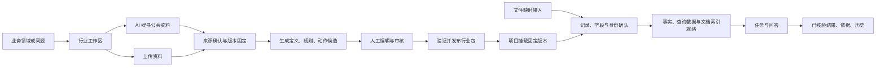

# 设计：A 阶段重塑为「Ontology 知识工作台」

状态：2026-10-15 设计稿（Codex 产出，待评审）。基线：main `065a43e`。
定位：在现有 A Core 之上补齐「工作入口、来源工作流、状态引导」，把 demo 感改成产品感。核心价值仍为可审核、可追溯、可固定版本。

## 0. 背景与问题

阶段 A（通用 Core）已验收合入 main，但产品形态被评「很 demo」：

- README 以「保存两行 CSV → 上传 → 建本体」开场，用户不知道如何开始使用，且「全是导入办公文件，很奇怪」。
- 缺少产品入口（第一屏）与清晰上手路径。
- 知识来源只体现了「手工上传文件」一种。

## 1. 目标形态

「通用知识工作台」：把某个业务领域，从**料源** → **可审核的行业资产** → **带依据的业务问答**串成能上手的工作流。两个工作对象：

- **行业工作区**：整理领域的术语、对象、关系、规则、动作，审核并发布可复用行业包。
- **项目**：挂载行业包，确认实际业务数据，完成带依据的任务与问答。

「本体生成助手」「业务实践助手」作为工作台内的辅助能力名称；用户先选要完成的工作，不必先理解 agent / mapping / 本体工程。

首期范围：三料源入口、两个工作台、真实待办与恢复路径、研究来源闭环、文件映射接入。数据库连接器、定时采集、OCR、自由爬虫、场景专业计算另行规划。

### 1.1 第一屏信息架构

```text
Ontology 知识工作台                 当前空间 ▾       设置

工作概览       行业工作台       项目工作台

当前工作：设备维护知识建设 ▾                         继续工作 →
希望整理哪个领域，或解决什么问题？
[ 输入领域或问题，例如“整理设备维护规则及其依据”       ]
[ 创建行业工作区 ]                  [ 使用已有行业包创建项目 ]

知识从哪里来？
[ AI 搜寻公共资料 ]    [ 上传或粘贴资料 ]    [ 接入结构化数据 ]
  调研后由你确认        文本、CSV、Excel       当前支持文件映射

现在需要你处理
• 3 个调研来源待确认    查看来源 →
• 2 条规则缺少依据      补充依据 →
• 项目“设备巡检”还有 8 行待确认   处理记录 →

工作进度
来源准备 → 资产审核 → 验证发布 → 项目准备 → 带依据问答
最近工作
行业工作区 / 项目 / 最近结果
```

关键交互：首次进入显示业务目标输入 + 三料源 + 已有行业包入口，无需先选内置演示行业；已有工作优先「继续工作 / 需要你处理」；业务用户已有包可直接建项目；未选工作对象点料源时轻量选择用途；新建工作区首步只需名称+业务目标；权限/能力不足展示原因与恢复入口，模型未配置不影响已有资料/历史/确定性任务。

首页进度是阶段状态与明确计数，不显示无法解释的百分比；「来源已保存 / 来源可用于建模 / 资产已发布 / 项目可查询」分别表达。

### 1.2 主价值路径



首次价值：行业维护者看到**第一组有真实来源、可改可审的候选资产**；业务用户得到**第一份可展开依据的已核验结果**。不得用「上传成功」或「生成了一张关系图」替代价值达成。

### 1.3 三料源

| 入口 | 用户操作 | 状态与输出 | 关键限制 |
|---|---|---|---|
| AI 搜寻生成 | 填业务目标/研究范围，确认外发内容与额度，开始调研 | 待开始→检索/归档→待确认来源→纳入建模→生成候选 | 研究产物不能直接发布或成为项目事实 |
| 自己上传 | 上传/粘贴，选用途，预览解析，确认来源性质 | 已保存→解析中→待确认/部分解析/失败→可用于建模或项目资料 | 上传不自动证明权威性 |
| 连数据源 | 选「文件映射」，选文件/sheet/列，预览规范值，确认映射 | 待映射→映射待确认→记录待确认→发布/构建中→就绪 | 明示是文件快照接入，不称实时同步 |

上传 CSV/Excel 按用途分流：**行业依据**（进工作区来源库，供定义/规则生成）或**项目记录**（进映射/确认/发布/物化）。可复用同一不可变原件，但两用途各自有成员关系、审核与授权，不能互相继承批准状态。「接入结构化数据」首期只做文件映射；数据库连接显示为规划能力及边界说明。

### 1.4 AI 搜寻的授权、费用与可信级别

开始前用简短确认面板说明：将向哪些搜索/模型服务发送哪些内容；允许搜索的域名/时间范围/目标；最多搜索次数、来源数、模型 token、时限；预计费用或「当前无法估算」及可强制执行的额度；只产候选、需人工确认。默认仅外发用户明确提交的公共研究 brief，不自动夹带项目记录/私有原文/历史问答/密钥。允许域名 = 部署/空间授权策略 ∩ 用户选择；输入域名不构成授权，模型不能扩大名单。

费用：调用前预留额度、调用后结算；重试/分页/并发共同扣减；有可信价格配置时展示金额估计并固定价格配置版本；无可靠报价则显示调用/token 上限，不伪造金额；用量未知保留未结算、不显示零成本、不自动继续消耗；用户主动追加调研是新的明确授权操作，失败重试不能借此重置原预算。

四级 trust tier 保留，UI 称「来源类别」，不用百分比：

| 契约值 | 展示 | 进入正式资产的条件 |
|---|---|---|
| `agent_researched` | AI 调研，待确认 | 不可直接支撑正式发布 |
| `public_standard` | 已确认公共标准/规范 | 人工确认发布者、适用范围、确切版本并固定来源 |
| `customer_authoritative` | 已确认业务权威资料 | 有授权人员确认业务权威性与适用范围 |
| `synthetic` | 合成验证资料 | 仅隔离验证，不能变为真实业务事实 |

**来源审核通过与可信类别提升是两件事**：接受某网页不代表它自动成为公共标准。厂商文档/行业文章/论坛等首期保留为研究参考，是否允许形成正式依据需单独定规则，不能随意塞进 `public_standard`。

### 1.5 两个工作台的页面与导航

| 工作台 | 页面 | 说明 |
|---|---|---|
| 行业 | 概览 | 目标、来源覆盖、候选数量、阻断项、下一步 |
| 行业 | 来源 | 三料源入口、研究任务、来源库、原文预览、审核与失效状态 |
| 行业 | 资产 | 对象/属性/关系、规则、动作（复用现有编辑与生成组件） |
| 行业 | 审核 | 当前修订差异、来源绑定、冲突、批准/驳回 |
| 行业 | 验证与发布 | 复用验证/CQ、发布阻断、不可变版本、导出 |
| 行业 | 版本与历史 | 包版本、草稿演进、来源变化、审核记录 |
| 项目 | 概览 | 挂载版本、生效修订、数据就绪、可用任务 |
| 项目 | 数据与资料 | 文件接入、mapping、项目文档与来源 |
| 项目 | 待确认 | 字段、单位、身份、关系端点、事实发布待办 |
| 项目 | 问答与任务 | 同页呈现自然语言入口与可用任务 |
| 项目 | 结果与历史 | 已核验正文/表格、证据、JSON 导出、历史版本 |

证据优先作为结果侧栏和来源详情出现。实例审核与语义事实审核**不能合并成含糊的「确认」**；产品上连续呈现并说明各自确认对象，服务端仍保留独立授权、审核记录与发布门槛。

### 1.6 PRD 增量（新编号 A-R，不改原 A.US/FR）

| 增量故事 | 验收标准 | 对齐原 A |
|---|---|---|
| A-R01 进入并开始工作 | 无预置行业也能建工作区；已有项目可直接继续；首屏显示三料源与真实待办 | US-001；FR-1、2、3 |
| A-R02 开展受控研究 | 开始前可见范围与额度；任务刷新可恢复；失败/取消/无结果/部分结果可区分 | US-003、013；FR-4、19、20 |
| A-R03 审核并纳入来源 | 审核后明确看到是否进入建模文档集；越权/版本冲突/无快照不能纳入 | US-003、005、009；FR-4、10、15 |
| A-R04 上传并确认用途 | 同一文件按行业依据/项目记录分流；格式与解析限制可见；不自动获得权威类别 | US-002、004、012；FR-7、8、9、16 |
| A-R05 文件映射接入 | 展示原值/规范值/单位/失败行；改 mapping 生成新修订；未就绪有恢复入口 | US-002、006；FR-8、11 |
| A-R06 完成行业资产发布 | 来源→候选→审核→验证→发布连续操作；动作未绑定与包已发布分别显示 | US-003、005、010；FR-4～6、10 |
| A-R07 完成项目问答 | 当前版本可用任务与阻断项可见；结果/依据/历史/导出同版 | US-007～014；FR-12～22 |
| A-R08 整栈验收 | 无手工上传的研究建模链与上传链分别走通；覆盖取消/跨范围/撤回/历史保持 | US-015、016 |

建议增加独立可用性验收：5 名首次使用者、不看 README、不接受口头指引，至少 4 名能在 2 分钟内判断进入哪个工作台、选料源并开始第一项有效操作。

## 2. 技术设计

继续模块化单体、Fastify、React/Vite、控制 PostgreSQL、不可变工件与 jobs/outbox。

### 2.1 契约与端口

| 契约/端口 | 复用与调整 |
|---|---|
| `CandidateSource` | 保留 kind/trust tier/原件引用与摘要；增可读标题、研究任务关联、来源审核记录引用 |
| 来源审核命令 | 增 `workspaceId`、理由、期望修订、依据引用；核对来源属于路径中工作区 |
| `CandidateSourceStore` | 补游标分页与完整性；审核保留追加事件与幂等回执，当前行只作最新投影 |
| `ModelingBrief` | 复用 goal/domains/freshness/mustCover；补标准版本、粒度、命名约定 |
| 研究请求 | 来源数量与生成候选数量分别建模，不再让一个 `candidateLimit` 承担两种语义 |
| `ResearchExecution` | 新增不可变 brief/policy/budget pins、job 引用、阶段结果引用、覆盖统计、停止原因；状态沿用 Job |
| `SourceAdmission` | 新增来源审核版本→解析版本→工作区文档集版本的绑定与回执 |
| `WorkbenchOverview` | 新增工作摘要、计数、下一步、阻断原因、能力、固定修订的只读投影 |
| 来源能力投影 | 各入口支持格式/上限、是否可研究/归档/生成、不可用原因 |
| mapping/compute/provenance | 继续用原契约，增必要展示投影，不重定义业务真值 |

注意：`ModelingBrief.targetKinds` 实际仅接受 object/attribute/relation；规则/动作继续走现有 rule-action 生成服务，研究请求可分别引用两类生成目标，不把定义枚举扩成万能候选类型。旧版本请求保持可读；涉及必填审计字段或状态语义变化时用版本化请求 Schema。跨层数据用运行时 Schema；新端口放 contracts，不暴露 Fastify/React/pg/provider SDK 类型。

### 2.2 Application 服务与关键事务

- `WorkbenchOverviewService`：读授权工作区/项目/候选/jobs/readiness/发布状态，产生确定性下一步（不能用模型猜待办）。
- `CandidateSourceReviewService`：处理来源类别、审核理由、权限、CAS、幂等与审核沿革。
- `WorkspaceSourceAdmissionService`：将确认的来源解析、校验并纳入固定文档集。
- `ResearchWorkflowService`：复用 `WebResearchService` + ingestion，编排有界搜索、快照归档、结果登记与恢复。
- 现有 `ProjectMappingService`、物化服务、生成/审核/发布服务继续承担原职责。

来源纳入顺序固定：① 读并校验来源归属/当前审核版本/目标工作区草稿；② 授权读取快照，复核 bytes/digest/格式/解析覆盖；③ 生成可回读的逻辑 document/parse 绑定（不能把任意 `artifact` 当合法 `document`）；④ 创建新不可变 `GroundingDocumentSet`，显式携带 trust tier、来源审核引用、解析选项；⑤ 控制事务内重查来源版本与工作区 CAS，追加 admission 记录并更新草稿引用；⑥ 成功返回新草稿与纳入回执，失败保留「已审核、尚未纳入」可恢复状态。

来源审核不自动改写已发布包。来源撤回/重新分类产生新事件与可见性 fence；当前发布/使用重新判断依赖，历史保留原快照与当时审核信息。**新研究/上传路径必须显式记录类别**，不能借默认值把未确认来源变成客户权威资料。

### 2.3 研究执行与快照

```text
预检与授权回执 → 建立研究 Job 和预算账本 → 有界查询规划
→ 通过既有 gateway 的 web_search 执行 → 归档可引用快照 → CandidateSource 入库
→ 保存覆盖统计与停止原因 → 等待用户来源确认
```

快照归档是 `web_search` 受控实现的内部能力，不新增模型可自由调用的 `fetch_url` 工具。快照适配器：归档实际内容字节及来源元数据（不能把搜索摘要当完整网页）；校验域名/重定向/网络目标，限制超时/下载量/解压量；记录内容形态、抓取时间、provider 版本、digest、归档范围与限制；无可归档内容的结果标「仅发现链接，不能作正式依据」；原文与派生解析内容分别保存引用与摘要。研究默认可先沿用 A 的有界执行上限，再由研究策略收紧；`truncated`/`excludedCount`/无快照数量/失败数量都进入结果。研究等待人工确认后，后续候选生成作为明确新操作建立自身预算、关联同一工作流程，不是失败重试、不能偷偷重置额度。

### 2.4 API 增量（`/api/v1`）

| API | 变化 | 行为 |
|---|---|---|
| `GET /workbench/overview` | 新增 | 授权空间摘要、分页待办、能力、数据时间/修订 |
| `GET /industry-workspaces/:id/overview` | 新增 | 来源、候选、验证、发布进度与阻断项 |
| `GET /projects/:id/overview` | 新增 | 挂载版本、待确认数量、readiness、可用任务 |
| `GET /industry-workspaces/:id/sources` | 扩展 | 游标分页、审核摘要、纳入状态；不改原列表身份 |
| `GET /industry-workspaces/:id/source-catalogue` | 新增 | 聚合上传成员与候选来源，按稳定来源关系去重 |
| `POST .../:id/research-runs` | 新增 | 固定 brief/策略/额度；202 返回 job/研究记录 |
| `GET .../:id/research-runs/:researchId` | 新增 | 阶段、用量、覆盖、停止原因、来源链接 |
| `POST .../:id/sources/:sid/reviews` | 加强 | 校验工作区归属、理由、类别转换、CAS、幂等 |
| `POST .../:id/source-admissions` | 新增 | 固定来源审核版本，创建新文档集与草稿修订 |
| `POST .../:id/source-retractions` | 新增 | 追加撤回事件与 fence，保留历史 |
| `POST .../:id/generations`、`rule-action-generations` | 扩展 | 可固定 brief 引用；复用已有候选生成与来源选择 |
| 现有上传/项目 mappings/runs/answer/history | 复用 | 新页面用原服务；必要时补能力与状态投影 |

现有同步 `POST .../research` 返回 201；新增异步入口避免直接改成 202 破坏响应契约；两入口共用同一授权与编排责任，不保留弱校验旁路。错误沿用现有 envelope（版本冲突返回当前修订及刷新建议；未配置/越权/预算耗尽/无快照/解析不支持/来源失效分别报告）。取消与进度优先复用现有 Job API。

### 2.5 前端与进度投影

复用并重组 `GuideHome`、`OntologyWorkspacePanel`、`WorkspaceSourcesPanel`、`DefinitionWorkbenchPanel`、`PackagePublicationPanel`、项目工作台与证据组件。导航沿用 query URL：

```text
/?view=start
/?assistant=ontology&workspace=<id>&tab=overview|sources|assets|review|validation|versions
/?assistant=business&project=<id>&tab=overview|data|review|tasks|history
```

兼容旧 `view=jobs/review/query/evidence` 与 run 深链接。刷新/前进后退/切换工作区保留正确上下文；不可见对象不能自动替换后继续原操作。

待办为服务端派生状态（无条件→选料源；有 proposed 来源→确认来源；已审核未纳入→完成纳入；有来源无候选→生成候选；…；能力齐备→开始任务）。概览投影不成为新的批准真值；点击执行时各业务服务重新授权与校验。`EvidenceSummary` 保留「事实前提」「规则原文」两轴，补来源类别/审核时版本/当前失效提示；不得把来源类别、检索排序或模型概率显示成「答案可信度」。

### 2.6 映射、计算与隔离

文件接入复用两层 mapping：`ImportMappingVersion`（原始列/JSON pointer→语义字段，含 sheet、表头摘要、精确单位转换、原文定位）与 `SemanticMapping`（批准记录→受控业务查询对象）。「文件数据源」首期从既有导入/membership/mapping/项目修订组合展示，不必马上加通用连接器实体。计算沿用 `OperationRegistry`、task binding、`data_query(kind=compute)` 与既有核验链；AI 只能提动作声明与参数候选，不能注册代码/计算金额/自行启用能力。

隔离：所有请求与 worker 身份来自可信上下文；来源审核检查 tenant/space/workspace，项目数据检查 project 与固定修订；研究索引/缓存/快照引用/用量/待办计数按范围隔离；候选来源不自动进入项目 corpus 或正式事实；项目采用工作区来源须经明确授权与成员绑定、固定版本；当前撤回状态影响新发布、历史回读不改写原答案；HTTP/local/MCP 共用服务与规则，不出现绕过审核的第二条入口。

### 2.7 持久化与迁移

保留 088，不编辑旧迁移。建议追加：

| 数据 | 存储 |
|---|---|
| 来源审核历史 | `candidate_source_review_events`（追加记录、理由、前后类别、actor、请求摘要） |
| 来源命令幂等 | 复用现有控制事务幂等机制，保存命令回执 |
| 来源纳入记录 | `workspace_source_admissions`（固定来源审核、解析、文档集、草稿引用） |
| 研究记录 | `workspace_research_runs`（关联既有 job/ledger、brief/policy refs、结果摘要） |
| 来源当前状态 | 在已有 `candidate_sources` 上加必要投影字段与索引 |
| 大文本与快照 | 继续保存于不可变工件，不塞进控制表 |
| 首页待办 | 首期查询投影，无独立待办真值表 |

所有键/唯一约束/外键/RLS 保持范围隔离。来源内容版本与审核修订分开。旧上传来源保留历史行为；缺少可证明审核事件时展示「历史路径确认」，不补造审核人/时间/理由。迁移编号实施时按实际 main 分配。

## 3. 可执行分解与 wave

> 编号为本设计临时节点号，不等于现有 V03/LOCAL 或 GitHub Issue。路径除标注外相对 `platform/`。

| 节点 | 标题 / 类型 | 依赖 | 验收标准 | 预期 scope |
|---|---|---|---|---|
| N00 | 冻结产品范围与增量契约 / docs | — | 明确双工作台、三入口、格式矩阵、状态词汇、A-R 验收；记录规格/实现差异 | 根 `tasks/prd-*`、`tasks/spec-*` |
| N01 | 来源、研究与概览契约 / backend | N00 | Schema 可运行校验；旧请求可读；来源数/候选数分离；错误及端口明确 | `packages/contracts/src/{candidate-source,modeling-brief,source-grounding}.ts`、新增契约、`schema/` |
| N02 | 工作台外壳与导航 / frontend | N00 | 零场景可进入；三入口与两工作台可导航；刷新/深链接/脏表单守卫通过 | `apps/web/src/components/{App,GuideHome}.tsx`、`navigation.ts`、样式 |
| N03 | 概览与真实待办 / backend | N01 | 待办来自持久状态；分页有界；权限变化后不泄露计数；返回具体恢复目标 | `packages/application/src/workbench/`、控制库读适配器、`http/workbench-overview.ts` |
| N04 | 来源审核、纳入与撤回 / backend | N01 | 审核事件可追溯；同 key 可回读；跨 workspace 拒绝；纳入 CAS；撤回保留历史 | `application/src/assets/candidate-sources/`、`assets/source-grounding/`、`control-postgres/`、迁移、`http/candidate-sources.ts` |
| N05 | 可归档的公共搜索适配 / infra | N01 | 实际字节归档与 digest 回读一致；越域/重定向/超限拒绝；无快照不冒充可引用 | `adapters/search-web/`、blob 适配连接、相关契约/集成测试 |
| N06 | 来源库与上传体验 / frontend | N01、N02 | 区分来源类别/审核/解析/纳入状态；显示原文；上传用途明确；冲突保留用户输入 | `WorkspaceSourcesPanel.tsx`、新增来源组件、`api/source-*` |
| N07 | 文件映射接入体验 / frontend | N02 | 两入口复用同一导入流程；原值/规范值/单位可对照；错误行定位；就绪不提前显示 | `CoreImportPanel.tsx`、项目 mapping/记录组件、现有 API client |
| N08 | 有界研究编排 / backend | N04、N05 | 持久 job；预算共享；取消迟到不纳入；重启恢复/限制明确；部分结果与用量可回读 | `assets/candidate-sources/web-research-service.ts`、新增编排、jobs、研究路由、worker |
| N09 | 行业工作流贯通 / frontend | N06 | 来源→生成→编辑→审核→验证→发布连续操作；原审核与 CQ 门不削弱；失败跳转到具体项 | `OntologyWorkspacePanel.tsx`、`DefinitionWorkbenchPanel.tsx`、`PackagePublicationPanel.tsx`、ontology 组件 |
| N10 | 项目任务与结果贯通 / frontend | N07 | 包挂载后按任务显示 readiness；问答与任务同入口；证据/历史同版；保留两类审核意义 | 项目工作台、`BusinessWorkbenchPanel.tsx`、`QueryPanel.tsx`、`project/EvidenceSummary.tsx` |
| N11 | 研究授权与进度界面 / frontend | N01、N02 | 展示外发范围与额度；可取消、刷新回读；无能力/无快照/无结果有明确状态；确认后引导生成 | 新增 `ResearchPanel`、研究 API client、复用 JobProgress |
| N12 | 正常启动装配与联调 / fullstack | N03、N08、N09、N10、N11 | 普通启动可发现研究能力；真实来源→文档集→候选连通；未配置能力有原因；无行业条件分支 | `apps/api/src/composition/core-assembly-*`、启动配置、deployment capability、Web 集成 |
| N13 | 整栈与隔离验收 / fullstack | N12 | 三入口与双工作台 E2E；真实 PG/工件；取消/撤回/并发审核/跨范围/1001 行/历史回归通过 | `tests/unit/`、`integration/`、`ui/`、`e2e/`、架构测试 |
| N14 | 上手文档与交付记录 / docs | N13 | README 从目标/入口开始；正常路径与当前支持一致；实际模型/受控响应分别记录；无 B 内容 | 根 `README.md`、启动指南、A 增量验收记录、相关 A 规格 |

建议分层：

- **Wave 0**：N00
- **Wave 1**：N01、N02
- **Wave 2**：N03、N04、N05、N06、N07、N11
- **Wave 3**：N08、N09、N10
- **Wave 4**：N12
- **Wave 5**：N13
- **Wave 6**：N14

`contracts` 公共出口、迁移编号、`App.tsx`、总 client、composition 各指定单一整合节点，减少并行冲突；各节点自己的测试随实现交付。最终检查含 `pnpm run verify`、`pnpm run boundaries`、受影响集成测试与浏览器 E2E；测试容器用项目标记命名卷并显式回收。

## 4. 风险与未决

| 问题 | 建议默认取舍 | 需明确 |
|---|---|---|
| 公共标准与网页使用权限 | 来源策略记录可检索/归档/展示/导出范围；不支持归档的内容不能伪装成固定原件 | 实际 provider/站点/资料的授权范围 |
| 厂商资料/专业文章归类 | 首期保留研究参考，不强行升为标准 | 是否调整四级分类或增独立发布资格策略 |
| 谁能提升来源类别 | 沿用现有角色体系，由有审核权限者确认，模型不能操作 | 行业审核者与平台管理员职责边界 |
| 真实成本上限 | 首期强制调用/token/时限上限；金额只在价格可靠时启用 | provider 计费接口、账户预算、价格维护责任 |
| 研究前就生成定义 | 首期先确认来源再生成正式候选，保持现有接地链 | 是否有「未确认来源上的探索草稿」需求 |
| 多轮自主研究 | 有界查询规划即可，不把多 agent 交叉研究作前置 | 用真实研究质量评估决定是否增加 |
| PDF 支持口径不一致 | 保留现有行业 PDF 路径；项目入口与 OCR 单独标注 | 后续统一格式矩阵的验收范围 |
| 真实数据库连接 | 本次只交付文件映射，连接器另设任务 | 只读账号、对象白名单、快照一致性、增量/删除语义、凭据托管 |
| 两次审核造成摩擦 | 连续展示、减少跳页，保留独立审核语义 | 若要一次提交多个审核，另定义事务与权限契约 |
| 来源撤回影响已发布知识 | 当前状态及时阻断/提示，历史按原版保存 | 哪些变化要求重新审核/重新发包/项目升级 |

优先投入：**来源确认后真正进入建模、首页知道下一步、项目数据就绪后直接进入问答**这三个衔接——它们决定用户能否独立完成工作；视觉与 README 随这条真实路径重塑。
